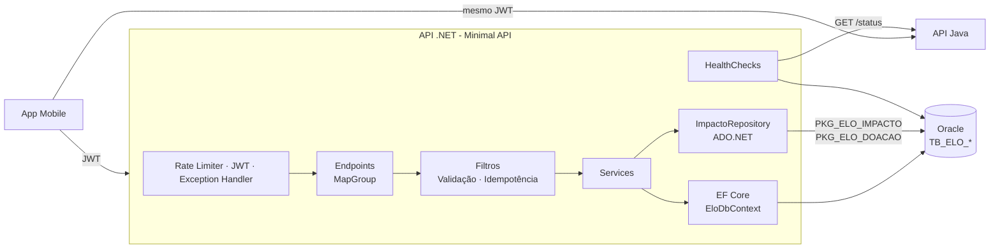

# EloSolidário API .NET — Advanced Business Development with .NET

Global Solution 2026/2 · CitizenTech · FIAP 2TDS

| Integrante | RM | Turma |
|---|---|---|
| Gabriel Cabral Mendes Mariano | 563230 | 2TDSPO |
| João Victor Santana dos Santos | 566063 | 2TDSPX |

- **Deploy:** https://elo-solidario-dotnet.onrender.com
- **Swagger:** https://elo-solidario-dotnet.onrender.com/swagger
- **Health:** https://elo-solidario-dotnet.onrender.com/health

## O problema e a solução

Muitas famílias vivem em insegurança alimentar enquanto alimentos ainda bons para consumo são descartados, porque falta uma ligação simples entre quem tem e quem precisa. O **EloSolidário** é uma rede comunitária de doação de alimentos com duas APIs consumidas pelo mesmo app Mobile:

| API | Responsabilidade |
|---|---|
| **Java (Spring Boot)** | Usuários, doações, reservas, notificações (RabbitMQ) e assistente com IA |
| **.NET (este repositório)** | Catálogo de alimentos, painel de impacto social e vitrine anti-desperdício |

Funcionalidades desta API que agregam valor ao cidadão:

- **Vitrine anti-desperdício** (`GET /doacoes/urgentes`): lista as doações que vencem em até N dias, com alerta (*VENCE HOJE*, *VENCE AMANHÃ*, *URGENTE*), para que o beneficiário retire primeiro o que corre risco de ser jogado fora.
- **Painel de impacto** (`GET /impacto`): mostra quilos destinados, energia estimada em kcal, refeições equivalentes (600 kcal cada) e beneficiários atendidos, para dar transparência à comunidade.
- **Catálogo com orientação de conservação**: cada alimento informa como guardar e transportar (ambiente, refrigerado ou congelado).

ODS atendidos: **2** (Fome Zero), **10** (Redução das Desigualdades) e **12** (Consumo e Produção Responsáveis).

## Tecnologias

.NET 8 · ASP.NET Core **Minimal API** · EF Core 8 + Oracle (Oracle.EntityFrameworkCore) · ADO.NET para os pacotes PL/SQL · JWT Bearer · Rate Limiting nativo (`Microsoft.AspNetCore.RateLimiting`) · HealthChecks · Swagger (Swashbuckle) · BCrypt · xUnit + WebApplicationFactory + EF Core InMemory · Docker

## Arquitetura



Organização (`src/EloSolidario.Api`):

| Pasta | Responsabilidade |
|---|---|
| `Endpoints` | Mapeamento das rotas com `MapGroup`, autorização, limites e documentação |
| `Services` | Regras de negócio (catálogo, autenticação, token e regras de impacto) |
| `Data` | `EloDbContext` (EF Core) e `ImpactoRepository` (chamadas PL/SQL) |
| `Domain` | Entidades e enums |
| `Dtos` | Contratos de entrada e saída, com DataAnnotations |
| `Infra/Validacao` | Filtro que valida os DTOs (a Minimal API não valida sozinha) |
| `Infra/Idempotencia` | Filtro de idempotência com `Idempotency-Key` |
| `Infra/LimiteRequisicoes` | Políticas de Rate Limiting e resposta 429 |
| `Infra/Saude` | HealthChecks do Oracle e da API Java e resposta em JSON |
| `Infra/Erros` | Tratamento global de exceções (`IExceptionHandler`) e resultado dos serviços |

## Requisito 1 — Minimal API, validações e Swagger

As rotas são registradas com `MapGet`, `MapPost`, `MapPut`, `MapPatch` e `MapDelete`, agrupadas por assunto com `MapGroup`. Cada endpoint declara no Swagger os códigos possíveis (`Produces`, `ProducesProblem`, `ProducesValidationProblem`). Os erros seguem o padrão **ProblemDetails** (RFC 9457).

Na Minimal API não existe a validação automática do `[ApiController]`. Por isso o `ValidacaoFilter<T>` executa as DataAnnotations do DTO e devolve **400** com os erros por campo:

```json
{
  "title": "Dados inválidos",
  "status": 400,
  "errors": {
    "nome": ["O nome deve ter entre 2 e 80 caracteres"],
    "conservacao": ["A conservação é obrigatória (AMBIENTE, REFRIGERADO ou CONGELADO)"],
    "calorias100g": ["As calorias por 100 g devem estar entre 0 e 900"]
  }
}
```

| Método | Rota | Acesso | Descrição |
|---|---|---|---|
| POST | `/auth/login` | público (limite de 5/min) | Login, devolve o JWT |
| GET | `/auth/me` | logado | Dados do usuário do token |
| GET | `/categorias` | logado | Categorias com a quantidade de alimentos |
| POST | `/categorias` | ADMIN + `Idempotency-Key` | Cria uma categoria |
| GET | `/alimentos?idCategoria=&nome=&conservacao=&pagina=&tamanho=` | logado | Catálogo paginado |
| GET | `/alimentos/{id}` | logado | Alimento com a orientação de conservação |
| POST | `/alimentos` | ADMIN + `Idempotency-Key` | Cadastra um alimento |
| PUT | `/alimentos/{id}` | ADMIN | Atualiza um alimento |
| PATCH | `/alimentos/{id}/ativo` | ADMIN | Ativa ou desativa um alimento |
| DELETE | `/alimentos/{id}` | ADMIN | Exclui (409 se já foi usado em doações) |
| GET | `/impacto` | logado | Painel de impacto social |
| GET | `/impacto/doadores/{id}` | logado | Impacto e selo de um doador |
| GET | `/doacoes/urgentes?dias=3&bairro=` | logado | Vitrine anti-desperdício |
| POST | `/admin/doacoes/expirar` | ADMIN + `Idempotency-Key` | Marca as doações vencidas |
| GET | `/health` e `/health/live` | público | HealthChecks |

## Requisito 2 — Autenticação e autorização com JWT

- `POST /auth/login` confere a senha (BCrypt) na tabela `TB_ELO_USUARIO` e devolve um token **HS256** com `iss=elo-solidario`, `sub` (e-mail), `id` e `perfil`, válido por 2 horas.
- O token é **compatível com o da API Java**: mesmo emissor, mesmas claims e mesmo segredo (`Jwt:Secret`). O app faz um login só e usa as duas APIs.
- O claim `perfil` vira o *role* do usuário (`RoleClaimType = "perfil"`). A política `Admin` (`RequireRole("ADMIN")`) protege as rotas de escrita. Sem token, a resposta é **401**, e com perfil sem permissão, **403**.

## Requisito 3 — Idempotência

Os POSTs que criam ou executam algo (`/categorias`, `/alimentos` e `/admin/doacoes/expirar`) exigem o cabeçalho **`Idempotency-Key`**. O `IdempotenciaFilter`:

1. monta a chave com usuário + método + rota + `Idempotency-Key` e calcula um **hash SHA-256 do corpo**;
2. marca a chave como *em processamento*, o que bloqueia duplicatas simultâneas com **409**;
3. guarda a resposta de sucesso (status, corpo e `Location`) por **24 horas** no `IDistributedCache`.

| Situação | Resposta |
|---|---|
| Sem `Idempotency-Key` | **400** |
| Primeira requisição | Executa normalmente (ex.: **201**) |
| Mesma chave e mesmo corpo | Devolve **a mesma resposta** sem executar de novo, com o cabeçalho `Idempotent-Replayed: true` |
| Mesma chave e corpo diferente | **422**: a chave já foi usada em outra operação |
| Mesma chave enquanto a primeira ainda está rodando | **409** |
| A primeira falhou (4xx) | Nada fica guardado, e o cliente pode corrigir e tentar de novo |

Exemplo: se o app reenviar o cadastro de um alimento por uma falha de rede, ele **não é duplicado**. Da mesma forma, `POST /admin/doacoes/expirar` repetido com a mesma chave não executa a procedure duas vezes. `PUT`, `PATCH` e `DELETE` já são idempotentes pela semântica do HTTP. Em produção com várias instâncias, basta trocar o `AddDistributedMemoryCache` por Redis, sem mudar o filtro.

## Requisito 4 — Rate Limiting

Configurado com o middleware nativo `AddRateLimiter` (valores em `appsettings.json` → `LimiteRequisicoes`):

| Política | Algoritmo | Limite | Chave |
|---|---|---|---|
| Global | Fixed window | 100 requisições/min | usuário do token (ou IP, se anônimo) |
| `login` | Fixed window | 5 tentativas/min | IP (proteção contra força bruta) |
| `escrita` | Sliding window (6 segmentos) | 20 requisições/min | usuário |

Ao estourar o limite, a API responde **429 Too Many Requests** com o cabeçalho `Retry-After` e um ProblemDetails explicando quando tentar de novo. O `/health` fica fora do limite para não atrapalhar o monitoramento.

## Requisito 5 — Testes com xUnit

```bash
dotnet test
```

**44 testes**, organizados em duas pastas:

| Pasta | Tipo | O que valida |
|---|---|---|
| `Unitarios/CatalogoServiceTests` | Unitário (EF InMemory) | Nome duplicado → conflito, categoria inexistente, exclusão bloqueada para alimento usado, paginação, orientação de conservação |
| `Unitarios/RegrasImpactoTests` | Unitário | Selo do doador, alerta de validade e cálculo de refeições |
| `Unitarios/TokenServiceTests` | Unitário | Claims do JWT e segredo mínimo |
| `Integracao/AutenticacaoTests` | Integração (`WebApplicationFactory`) | 401 sem token, login, 400 de validação e 403 por perfil |
| `Integracao/AlimentoEndpointsTests` | Integração | CRUD completo, paginação, 404, 409 e 400 |
| `Integracao/IdempotenciaTests` | Integração | Replay sem duplicar, 422 com outro corpo, 400 sem chave, procedure executada uma única vez |
| `Integracao/LimiteRequisicoesTests` | Integração | 429 com `Retry-After` no login |
| `Integracao/ImpactoESaudeTests` | Integração | Painel, vitrine e `/health` |

Nos testes de integração, a API sobe inteira em memória: o Oracle é trocado pelo EF Core InMemory, e o repositório de PL/SQL por um repositório falso.

## Requisito 6 — HealthChecks

`GET /health` (público) responde em JSON:

```json
{
  "status": "Healthy",
  "duracaoMs": 9.2,
  "verificacoes": [
    { "nome": "api", "status": "Healthy", "descricao": "API .NET no ar" },
    { "nome": "oracle", "status": "Healthy", "descricao": "Conexão com o Oracle disponível", "dados": { "tempoRespostaMs": 7 } },
    { "nome": "api-java", "status": "Healthy", "descricao": "API Java (doações e reservas) respondendo", "dados": { "statusHttp": 200 } }
  ]
}
```

| Verificação | Como | Se falhar |
|---|---|---|
| `api` | Verificação interna | — |
| `oracle` | `Database.CanConnectAsync()` no `EloDbContext` | **Unhealthy** → HTTP 503 |
| `api-java` | `GET {ApiJava:Url}/status` com timeout de 5 s (serviço externo) | **Degraded** → HTTP 200: o catálogo e o impacto continuam funcionando |

`GET /health/live` verifica só se o processo está no ar, para o orquestrador (Render ou Azure).

## Integração com o banco (PL/SQL)

| Endpoint | Objeto Oracle |
|---|---|
| `GET /impacto/doadores/{id}` | `pkg_elo_impacto.fn_total_kg_doado` e `pkg_elo_impacto.fn_calorias_doacao` |
| `GET /doacoes/urgentes` | `pkg_elo_doacao.fn_dias_para_vencer` |
| `POST /admin/doacoes/expirar` | `pkg_elo_impacto.prc_expirar_doacoes` (parâmetro `OUT`) |

As tabelas, pacotes e gatilhos são criados pelos scripts da disciplina de Banco de Dados (`01_ddl.sql` a `04_inserts.sql`).

## Como rodar

Pré-requisitos: .NET 8 SDK e um Oracle com os scripts do Banco executados.

1. Configure as variáveis de ambiente (nunca grave credenciais no `appsettings.json`):

   | Variável | Exemplo |
   |---|---|
   | `ConnectionStrings__Oracle` | `User Id=rmXXXXXX;Password=senha;Data Source=oracle.fiap.com.br:1521/ORCL` |
   | `Jwt__Secret` | o mesmo segredo da API Java (pelo menos 32 caracteres) |
   | `ApiJava__Url` | URL da API Java, ex.: `https://elo-solidario-java.onrender.com` |

2. Execute:

   ```bash
   dotnet run --project src/EloSolidario.Api
   ```

3. Acesse `http://localhost:5080/swagger`, faça o login em `/auth/login` e clique em **Authorize** com o token.

Usuários de teste (senha **`Elo@2026`**): `admin@elosolidario.com` (ADMIN), `ana.souza@email.com` (DOADOR) e `maria.oliveira@email.com` (BENEFICIARIO).

### Docker e deploy no Render

```bash
docker build -t elo-solidario-dotnet .
docker run -p 8080:8080 -e ConnectionStrings__Oracle="..." -e Jwt__Secret="..." -e ApiJava__Url="..." elo-solidario-dotnet
```

O `Dockerfile` roda os testes durante o build e usa a porta da variável `PORT`, como o Render exige. No Render: **New Web Service → Docker**, apontando para este repositório e cadastrando as três variáveis acima.

## Declaração de uso de IA

Ferramenta utilizada: Claude (Anthropic), como apoio na revisão do código, na explicação de conceitos (Minimal API, idempotência e rate limiting) e na revisão do texto deste README. O código foi revisado, executado e testado pelos integrantes.
